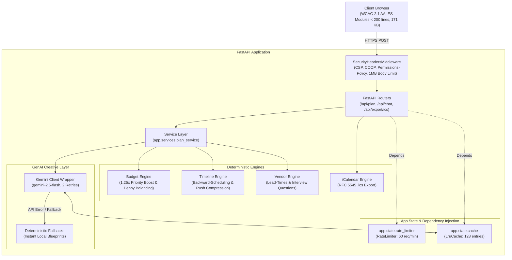
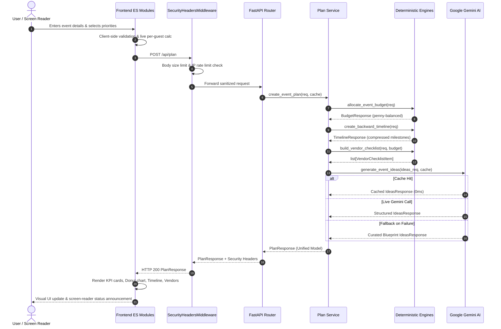

# EventCraft AI - System Architecture

> **"Let Python do the math. Let AI do the vibe."**

EventCraft AI is an enterprise-grade, accessible event planning platform that pairs **deterministic Python calculation engines** with **generative AI (Google Gemini 2.5 Flash)**. By strictly decoupling financial math and scheduling logic from LLM generation, EventCraft AI completely eliminates hallucinated budgets, impossible deadlines, and erratic timeline calculations.

---

## 1. High-Level Architecture Overview

EventCraft AI follows a layered, decoupled service architecture. Global mutable state is eliminated; `RateLimiter` and `LruCache` are instantiated inside `create_app()`, stored on `app.state`, and injected via FastAPI `Depends`:



---

## 2. Layered Component Architecture

### Layer 1: Frontend Client Presentation (`/static`)
- **Zero Build Step**: Native ECMAScript Modules (`<script type="module" src="/static/app.js">`) executable in all modern browsers without Webpack, Vite, or Babel. Total bundle size is **171 KB** on disk.
- **Modular Stylesheets**: Organized into 11 discrete stylesheets under `static/css/` (`tokens.css`, `base.css`, `layout.css`, and 8 component stylesheets).
- **Strict Modularity**: Each module is focused and strictly kept **under 200 lines**:
  - `static/app.js`: Application coordinator, tab roving tabindex, accessibility controls.
  - `static/js/planner.js`: Plan generation submission, skeleton loading, and render delegation.
  - `static/js/budget.js`: Accessible SVG donut chart, color legend, itemized allocation table.
  - `static/js/timeline.js`: Phase-grouped vertical timeline, critical task filter toggle.
  - `static/js/vendors.js`: Interactive vendor cards, budget caps, booking deadlines, localStorage progress persistence.
  - `static/js/ideas.js`: Creative themes, culinary concepts, and decor suggestions with AI vs Template badges.
  - `static/js/chat.js`: Interactive planning assistant query handler with suggested question chips.
  - `static/js/export.js`: Native iCalendar (.ics) export and plain-text clipboard copy.
  - `static/js/form.js`: Form submission binding, real-time per-guest cost calculation, and character counters.
  - `static/js/form_validation.js`: Form field boundary validation and accessible error summary management.
  - `static/js/scenarios.js`: Instant sample scenario loaders (Wedding, Birthday, Community).
  - `static/js/state.js`: Centralized application state and scenario definitions.
  - `static/js/utils.js`: Safe DOM creation (`createEl`, `createSvgIcon`), currency formatting (`Intl.NumberFormat`), screen-reader announcements (`aria-live`).
- **XSS Immunity**: Absolute ban on `.innerHTML` and `insertAdjacentHTML`. All user data and API responses are bound exclusively via `document.createTextNode` and `element.textContent`.
- **WCAG 2.1 AA Accessibility**:
  - Skip-to-content links (`#main-content`).
  - Full keyboard accessibility for tabs (`ArrowLeft`, `ArrowRight`, `ArrowUp`, `ArrowDown`, `Home`, `End`).
  - High-contrast color tokens exceeding 5.7:1 ratio with Windows High Contrast (`forced-colors: active`) support.
  - Interactive target sizes $\ge 44 \times 44\text{px}$ across all buttons, inputs, tabs, and chips.
  - Screen reader live regions (`role="status"`, `aria-live="polite"`).
  - Explicit form fieldsets, legends, `autocomplete` attributes, and inline error summaries linked via anchor IDs.

---

### Layer 2: Security & Sanitization Layer (`app/security.py`, `app/sanitizer.py`)
- **Security Headers Middleware**: Injects strict OWASP-compliant security headers on all responses:
  - `Content-Security-Policy`: Restricts scripts, styles, and fonts to origin and trusted CDNs.
  - `X-Frame-Options: DENY`: Prevents clickjacking.
  - `X-Content-Type-Options: nosniff`: Prevents MIME-sniffing attacks.
  - `Referrer-Policy: strict-origin-when-cross-origin`: Minimizes referrer leakage.
  - `Permissions-Policy: geolocation=(), camera=(), microphone=()`: Blocks sensitive hardware APIs.
  - `Cross-Origin-Opener-Policy: same-origin`: Isolates browsing context against cross-origin attacks.
- **Request Body Size Limit**: Strictly limits incoming payload size to 1 MB (`MAX_REQUEST_BODY_SIZE = 1_048_576`), returning HTTP 413 for oversized requests.
- **Non-Spoofable Rate Limiting**: Per-IP sliding window rate limiting based on `request.client.host` (ignoring spoofable client headers).
- **Unified Sanitization Module (`app/sanitizer.py`)**:
  - Strips invisible Unicode and dangerous control characters (`[\x00-\x08\x0B\x0C\x0E-\x1F\x7F]`).
  - Escapes HTML entities (`&`, `<`, `>`, `"`, `'`) for safe client reflection.
  - Redacts sensitive personal information (emails, phone numbers) before passing context to LLM prompts.
  - Validates future event dates and priority category counts.
  - Masks internal exception traces using generic RFC 7807 problem details in production.

---

### Layer 3: Centralized Constants & Domain Models (`app/constants.py`, `app/models.py`)
- **Centralized Constants (`app/constants.py`)**:
  - Zero circular imports between engine profiles, AI client, and Pydantic schemas.
  - Named limits: `MIN_GUEST_COUNT` (1), `MAX_GUEST_COUNT` (2000), `MAX_NOTES_LENGTH` (500), `DEFAULT_CACHE_MAX_SIZE` (128), `DEFAULT_MAX_RETRIES` (2).
- **Strong Typing with Pydantic v2**:
  - Domain models: `EventRequest`, `BudgetResponse`, `TimelineResponse`, `PlanResponse`, `HealthResponse`.
  - Type-safe data structures (`NamedTuple`): `ProfileCategory`, `TaskTemplate`, `VendorSpec`, `FeasibilityResult`, `BudgetBuildResult`.
  - Full PEP 561 compliance via `app/py.typed`.

---

### Layer 4: Service Orchestration Layer (`app/services/plan_service.py`)
- Coordinates domain workflows between deterministic engines and creative AI generation.
- Assembles warnings combining budget feasibility alerts and timeline rush compression notices.
- Fully decoupled from HTTP transport and routing decorators, enabling direct testing and alternate client adapters.

---

### Layer 5: Deterministic Computation Engines (`app/engine/`)
1. **Budget Engine (`app/engine/budget.py`)**:
   - Shifts category percentages according to user priorities using a deterministic multiplier (`1.25x`).
   - Normalizes non-contingency categories to ensure the contingency reserve (`5% - 20%`) is strictly protected.
   - Applies penny balancing algorithm (`_balance_penny_discrepancy`) ensuring exact zero-discrepancy equality with total budget down to the rupee/cent.
   - Evaluates per-guest minimum thresholds and generates structured feasibility recommendations when underfunded.
2. **Timeline Engine (`app/engine/timeline.py`)**:
   - Computes backward-scheduled milestone dates from target event date using standard lead times.
   - Automatically detects compressed planning windows (`lead_time_days < standard_lead_time_days`).
   - Applies non-linear task compression with priority preservation and emits rush timeline warnings.
3. **Vendor Engine (`app/engine/vendors.py`)**:
   - Computes category-specific booking deadlines and matches budget allocations.
   - Provides structured interview vetting questions for each vendor category.
4. **iCalendar Engine (`app/engine/ics.py`)**:
   - Generates RFC 5545 compliant `.ics` calendar files for one-click import into Google Calendar, Apple Calendar, and Outlook.

---

### Layer 6: GenAI Creative Layer (`app/ai/`)
- **Google GenAI SDK**: Powered by `google-genai` and `gemini-2.5-flash`.
- **Structured Schema Enforcement**: Uses `IdeasResponse` Pydantic model directly as `response_schema` to enforce deterministic JSON structures from the generative model.
- **LRU In-Memory Cache**: Computes deterministic SHA-256 hashes of input payloads to instantly serve repeat requests with 0ms network latency and zero API cost.
- **Deterministic Offline Fallbacks (`app/ai/fallback.py`)**: Curated event planning blueprints ensure 100% application functionality even during network outages or missing API keys.

---

## 3. Request-Response Data Flow



---

## 4. Quality, Testing & CI Standards

- **Static Type Checking**: `mypy --strict app tests` with 100% typed functions, zero `Any` leakage, and strict optional checking across all 42 source files.
- **Linter & Complexity**: `ruff check .` with McCabe cyclomatic complexity limit (`max-complexity = 5`, `C901`) enforced in CI.
- **Code Quality**: `pylint app tests` maintaining a perfect **10.00 / 10.00** rating.
- **Radon Cyclomatic Complexity**: 100% Grade A cyclomatic complexity (`radon cc app -n B` returns 0 violations) and 100% Grade A maintainability index (`radon mi app -n B` returns 0 violations).
- **Vulnerability Scanning**: `pip-audit` automated in CI ensuring zero known CVEs in pinned dependencies.
- **Test Suite**:
  - **62 Python automated tests** (`pytest --cov=app`) with **96.14% total code coverage** (failing under 90% threshold) executing in < 10 seconds.
  - **9 Node.js unit tests** (`node --test tests/js/*.test.js`) verifying pure JavaScript formatters and validation helpers.
  - Architectural AST inspection tests guaranteeing that `app.engine` never imports from `app.api`, `app.services`, or `app.ai`.
  - Frontend asset accessibility (skip links, single h1, fieldsets, ARIA roles, zero innerHTML).

---

## 5. Architectural Layers & Dependency Rule

EventCraft AI strictly enforces a unidirectional four-layer dependency hierarchy:

```
[ app.api (routes_plan, routes_chat, routes_export) ]
                       │
                       ▼
[ app.services (plan_service) ]
          │                   │
          ▼                   ▼
[ app.engine (pure math) ]  [ app.ai (creative layer) ]
          │                            │
          ▼                            ▼
[ app.engine.data ]          [ app.ai.data ]
```

1. **`app.api`**: Thin routing layer declaring endpoint signatures, parameter constraints, OpenAPI documentation, and response schemas. Routes inject dependencies (`RateLimiter`, `LruCache`) from `app.state` and delegate to services.
2. **`app.services`**: Orchestration layer coordinating deterministic calculations with creative AI generation.
3. **`app.engine`**: Pure deterministic calculation modules (budget, timeline, vendors, ICS export). Zero external I/O and zero dependencies on higher layers (`app.api`, `app.services`, `app.ai`), verified via automated AST inspection tests.
4. **`app.ai`**: GenAI client and resilient deterministic fallbacks.
5. **Data vs Logic Split**: Task templates, vendor interview specifications, and canned conversation dispatch rules reside exclusively in `app.engine.data` and `app.ai.data` as typed constants.

---

## 6. Code Quality Suppressions & Justifications

To preserve strict type safety and code health, blanket `noqa`, wildcard `type: ignore`, and broad disables are forbidden. Every remaining linter suppression is isolated and explicitly justified:

| File | Suppression | One-Line Justification |
| :--- | :--- | :--- |
| `app/security.py` | `# pylint: disable=too-few-public-methods` | Starlette `BaseHTTPMiddleware` contract specifically requires implementing only the single `dispatch` method. |
| `app/ai/gemini_client.py` | `# pylint: disable=broad-exception-caught` | Required for resilience to ensure external network or Gemini API failures gracefully fall back without crashing the plan generation. |
| `pyproject.toml` | `ignore = ["B008"]` | FastAPI's standard dependency injection and parameter defaults (`Query(...)`, `Depends(...)`) require function calls in default arguments. |
| `pyproject.toml` | `ignore = ["ANN401"]` | Necessary for generic in-memory caching wrappers that accept arbitrary JSON-serializable argument types (`Any`). |
| `pyproject.toml` | `ignore = ["D104"]` | Package `__init__.py` marker files do not require redundant multi-line docstrings. |
| `pyproject.toml` | `ignore = ["D203", "D213"]` | Mutually conflicting docstring summary line formatting rules in Google vs NumPy styles. |
| `tests/*` | `ignore = ["S101", "ANN", "D"]` | Pytest test functions rely on standard `assert` statements and do not require production API docstrings or return type annotations. |
