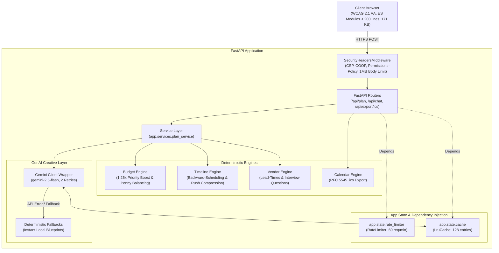

# EventCraft AI 🎪✨

[](https://github.com/Dhinakarg/EventCraft/actions/workflows/ci.yml)
[](https://www.python.org/downloads/)
[](https://github.com/astral-sh/ruff)
[](https://mypy-lang.org/)
[](https://pylint.pycqa.org/)
[](docs/ACCESSIBILITY.md)
[](LICENSE)

> **"Let Python do the math. Let AI do the vibe."**

EventCraft AI is an accessible, deterministic event planning engine for **weddings**, **birthdays**, and **community festivals**. It pairs deterministic Python computation engines with **Google Gemini 2.5 Flash** for bespoke themes, decor, and chat assistance — with zero hallucinated arithmetic and complete offline resilience.

---

## ⚡ Measured Engineering Highlights

- 💰 **Exact Arithmetic & Priority Shifting**: Budget allocations balanced down to the penny/rupee with a protected 5%–10% contingency buffer and a **1.25x** priority category boost multiplier.
- ⏱️ **Backward Timeline Scheduling**: Generates milestone due dates from the target event date backward, featuring automated rush detection and deadline compression.
- 📋 **Vendor Checklists**: Pre-negotiation interview questions and category-specific budget caps.
- 🎨 **Creative Ideas Layer**: Google Gemini 2.5 Flash with **2** automatic retry attempts, SHA-256 LRU caching, and 100% offline fallback blueprint support.
- ♿ **WCAG 2.1 AA Compliant**: High-contrast dark/light mode, Windows forced-colors support, full keyboard navigation with ARIA roving tabindex, screen-reader live regions, $\ge 44 \times 44\text{px}$ interactive targets, and zero `innerHTML`.
- 🛡️ **Hardened Security**: Strict CSP, Permissions-Policy, Cross-Origin-Opener-Policy, non-spoofable IP rate limiting (`request.client.host`), 1 MB request payload size enforcement, input sanitization, and PII masking.
- 📦 **Zero-Build Frontend**: **171 KB** total static assets on disk (HTML 32.5 KB, CSS 72.7 KB, JS 65.6 KB) running native ES modules and modular CSS stylesheets with zero Node bundler step required.

---

## 🏛️ Architecture & Dependency Flow

EventCraft AI strictly enforces a unidirectional four-layer dependency hierarchy. Global mutable state is eliminated; `RateLimiter` and `LruCache` are instantiated inside `create_app()`, managed on `app.state`, and cleanly injected via FastAPI `Depends`:



*For complete technical details, see [ARCHITECTURE.md](ARCHITECTURE.md).*

---

## 🚀 Quick Start

### 1. Clone & Install
```bash
git clone https://github.com/Dhinakarg/EventCraft.git
cd EventCraft
python -m venv .venv
source .venv/bin/activate  # On Windows: .\.venv\Scripts\activate
pip install -r requirements.txt
```

### 2. Configure Environment (Optional)
```bash
cp .env.example .env
# Add your GEMINI_API_KEY (if omitted, high-quality curated fallbacks run automatically)
```

### 3. Run Application
```bash
uvicorn app.main:app --host 127.0.0.1 --port 8000 --reload
```
Open [http://127.0.0.1:8000](http://127.0.0.1:8000) in your browser.

---

## 📡 Sample Request & Response

### Sample Request
```bash
curl -X POST http://127.0.0.1:8000/api/plan \
  -H "Content-Type: application/json" \
  -d '{
    "event_type": "wedding",
    "event_date": "2026-12-15",
    "guest_count": 100,
    "total_budget": 500000.0,
    "currency": "INR",
    "city": "Bengaluru",
    "vibe": "Modern Minimalist",
    "priorities": ["venue", "food"],
    "notes": "Eco-friendly decor and local floral arrangements."
  }'
```

### Actual Output (Direct from Engine & AI)
```json
{
  "budget": {
    "total_budget": 500000.0,
    "currency": "INR",
    "items": [
      {
        "category": "Venue & Facility",
        "percentage": 31.54,
        "allocated_amount": 157710.29,
        "description": "Primary venue space, rentals, and setup",
        "priority": "High",
        "tips": "Target ~INR 157,710.29 (31.54%)."
      },
      {
        "category": "Catering & Bar",
        "percentage": 31.54,
        "allocated_amount": 157710.28,
        "description": "Full dinner, appetizers, beverages, and service staff",
        "priority": "High",
        "tips": "Target ~INR 157,710.28 (31.54%)."
      },
      {
        "category": "Decor & Florals",
        "percentage": 8.41,
        "allocated_amount": 42056.07,
        "description": "Centerpieces, bouquet, ceremony arch, and styling",
        "priority": "Medium",
        "tips": "Target ~INR 42,056.07 (8.41%)."
      }
    ]
  },
  "timeline": {
    "tasks": [
      {
        "id": "w1",
        "title": "Tour and lock ceremony & reception venue",
        "phase": "Vision & Venue",
        "due_date": "2026-10-30",
        "days_before_event": 46,
        "priority": "Urgent Critical",
        "is_critical": true,
        "status": "todo"
      },
      {
        "id": "w2",
        "title": "Interview and contract caterer and bar",
        "phase": "Vendor Sourcing",
        "due_date": "2026-11-09",
        "days_before_event": 36,
        "priority": "Urgent Critical",
        "is_critical": true,
        "status": "todo"
      }
    ]
  },
  "vendors": [
    {
      "category": "Venue & Facility",
      "budget_cap": 157710.29,
      "booking_deadline": "2026-10-30",
      "lead_time_days": 210,
      "questions_to_ask": [
        "What is the noise curfew and teardown deadline?",
        "Are we required to use exclusive in-house caterers?",
        "What bad-weather indoor backup room is guaranteed?"
      ],
      "status": "todo"
    }
  ],
  "ideas": {
    "themes": [
      "Modern minimalist Garden Romance with ambient taper candles",
      "Timeless Modern minimalist Minimalism with architectural floral installations",
      "Modern minimalist Starlight Soirée with suspended twinkling fairy lights"
    ],
    "menu_ideas": [
      "Plated Pan-Seared Bass or Herb Risotto (Omnivore & Vegetarian adapted)",
      "Artisanal salad with edible blossoms, toasted hazelnuts, and citrus vinaigrette"
    ],
    "source": "fallback"
  },
  "warnings": [
    "Rush plan: Available lead time (46 days) is less than standard (270 days). Non-critical tasks are deferred; lock critical vendors now."
  ]
}
```

---

## 🧪 Testing & Quality Gates

EventCraft AI maintains strict quality standards across all Python and JavaScript modules:

```bash
# Run 62 Python tests with whole-app coverage enforcement (>=90%)
pytest --cov=app --cov-report=term-missing --cov-fail-under=90
# Outcome: 62 passed, 96.14% total code coverage

# Run 9 pure JavaScript unit tests
npm test
# Outcome: 9 passed, 0 failures

# Run static quality pipeline
ruff check .
ruff format --check .
mypy --strict app tests
pylint app tests
radon cc app -n B  # 100% Grade A cyclomatic complexity (zero Grade B or higher)
pip-audit          # Zero known dependency vulnerabilities

# Or run complete verification with one command:
make verify
```

---

## 📡 API Endpoints

| Method | Endpoint | Description |
| :--- | :--- | :--- |
| `POST` | `/api/plan` | Generates complete event plan with budget, timeline, vendors, and creative ideas. |
| `POST` | `/api/chat` | Conversational assistant for plan refinement (constrained strictly to event planning). |
| `GET` | `/api/export/ics` | Exports timeline tasks as an RFC 5545 standard `.ics` calendar file. |
| `GET` | `/health` | Service health check returning operational status, service ID, and active Gemini model. |

---

## ♿ Accessibility & Standards

EventCraft AI is built to be accessible to all users out of the box:
- **WCAG 2.1 Level AA**: Meets all contrast ($\ge 5.7:1$), zoom (200%), and 320px reflow criteria.
- **Screen Reader Ready**: Full ARIA tab patterns, announcements via `#status-announcer`, and proper form field grouping.
- **Forced Colors Mode**: Windows high-contrast compatibility with explicit `Highlight` and `ButtonText` tokens.
- **Target Size**: Minimum $\ge 44 \times 44\text{px}$ interactive touch/click targets across all buttons, tabs, inputs, and chips.
- **Zero Third-Party CDNs**: Local assets only with system font fallbacks and lightweight SVG sprites.

*Detailed audit reports are documented in [docs/ACCESSIBILITY.md](docs/ACCESSIBILITY.md).*

---

## 📄 License

MIT License. Designed and built with deterministic reliability and modern accessibility.
